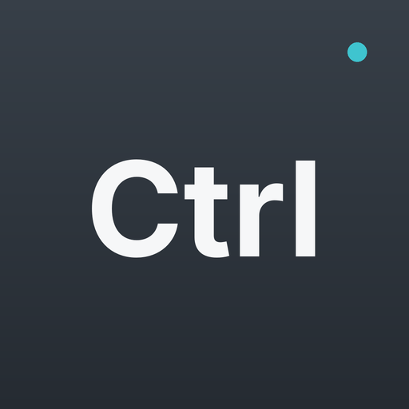

# Ask the Clock (Ctrl Worx Watch List)

Ask the Clock is a free MCP server that reads data and never changes it. It answers whether a public company is on the Ctrl Worx Watch List: its own SEC filings report a material weakness in internal control over financial reporting, and no later annual report of its own says the weakness is fixed. It also says how long the company has been on the Clock.

Every answer gives its as-of date, a link to the company's SEC filing on EDGAR and a link to the corrections page.

This repository holds documentation, no code. The server runs at ctrlworx.com, so there is nothing to install.

## Connect

| | |
|---|---|
| Server address | `https://ctrlworx.com/wp-json/ctrlworx/v1/ask-the-clock` |
| Transport | Streamable HTTP |
| Authentication | None |
| MCP Registry name | `com.ctrlworx/ask-the-clock` |

- **Claude:** open Ask the Clock in the Claude directory and click Connect to Claude.
- **ChatGPT:** open Ask the Clock in ChatGPT and click Install plugin. Developers can also add it in Developer mode as a custom app with the server address above.
- **Perplexity:** add it as a custom connector (Remote MCP) with the server address above and Authentication set to None.
- **Other MCP clients:** add it as a Streamable HTTP server with the address above. See [llms-install.md](llms-install.md).

Step-by-step page: https://ctrlworx.com/ask-the-clock/ (short address: asktheclock.com)

## Tools

| Tool | What it does | Input |
|---|---|---|
| `lookup_company` | One company: whether it is on the Watch List, its status, years on the Clock, the date its Clock started, the latest filing that reports the weakness with its SEC link, its ctrlworx.com page and the as-of date. When a name matches more than one company, it returns candidates instead of a status. | `query`: ticker, full company name or SEC CIK number |
| `clock_headline` | The totals: public companies on the Clock, how many have been on the Clock more than one and three years, and the full on-record count, plus the frozen October 2026 report figures. | none |

Both tools read data and never change it.

## Example questions

- "Is [company name] on the Ctrl Worx Watch List?"
- "Look up ticker [ticker] on the Clock."
- "Check CIK [CIK number]."
- "How many public companies are on the Clock right now?"

## Where the data comes from

Every company on the Watch List is there because of a sentence in its own 10-K or 10-Q on SEC EDGAR. We read filings from January 2021, so time on the Clock is a minimum. How the Watch List works: https://ctrlworx.com/watch-list/method/

A material weakness is a statement about internal control, not a finding of wrongdoing, and nothing here is investment advice. Ctrl Worx is independent and has no tie to the SEC or any government body.

## Privacy and limits

Ask the Clock stores no personal data and doesn't log questions against a person. To keep it fast for everyone it keeps a short-lived counter, deleted automatically within 24 hours, keyed by a hashed form of the caller's address.

- Privacy policy: https://ctrlworx.com/privacy-policy/
- Terms: https://ctrlworx.com/clock-for-your-site/#terms

## Corrections and help

- Corrections and right of reply: https://ctrlworx.com/watch-list/corrections/
- Questions or a wrong result: email russell@ctrlworx.com

## Also from Ctrl Worx

- Watch List: https://ctrlworx.com/watch-list/
- The Clock on your own website (free widget): https://ctrlworx.com/clock-for-your-site/

Ctrl Worx LLC · https://ctrlworx.com/
